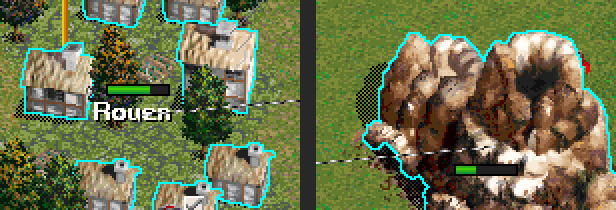
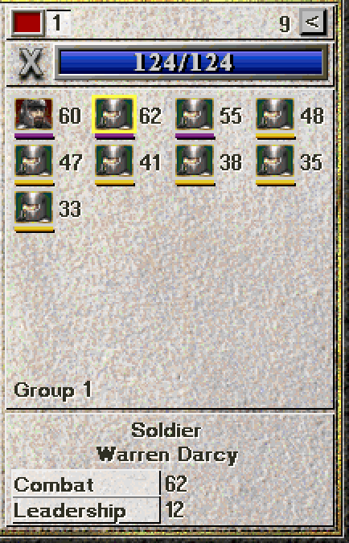
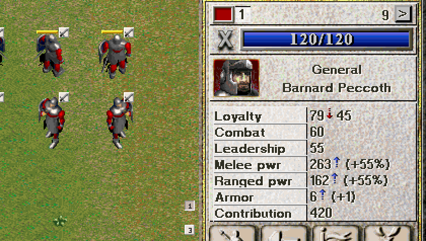
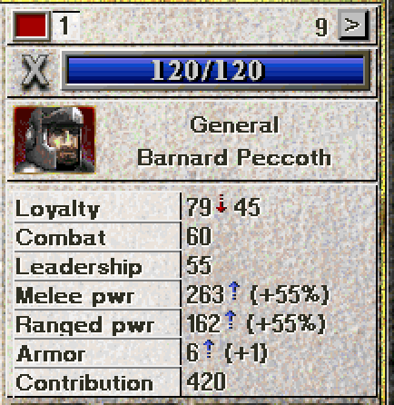
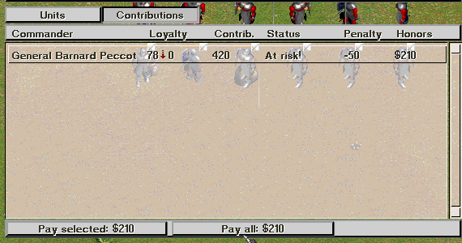
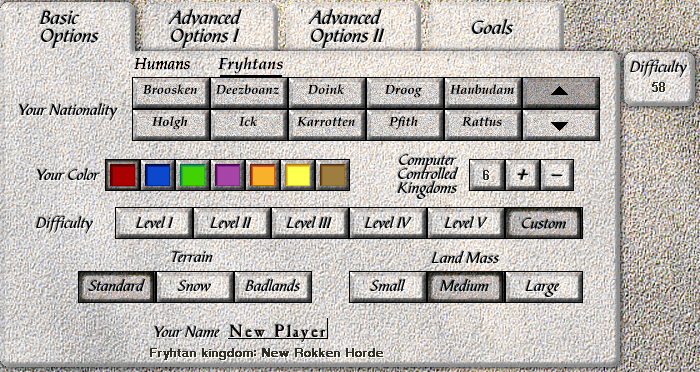
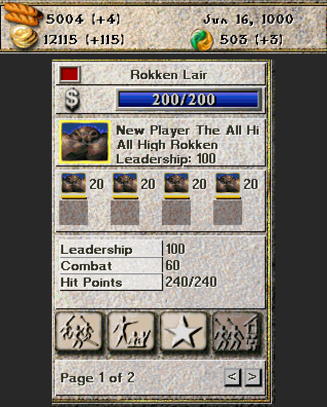
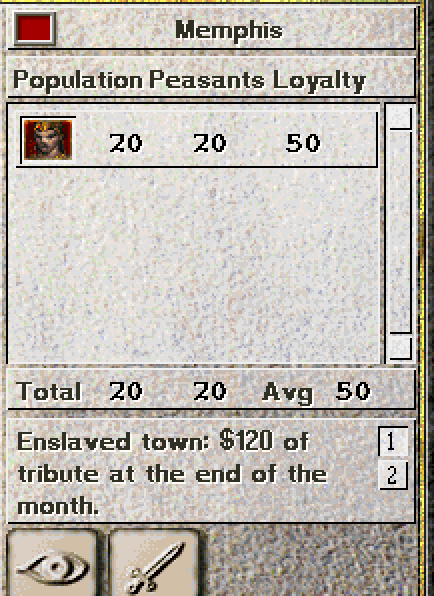
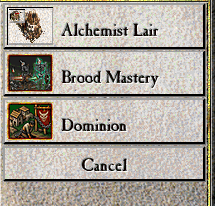
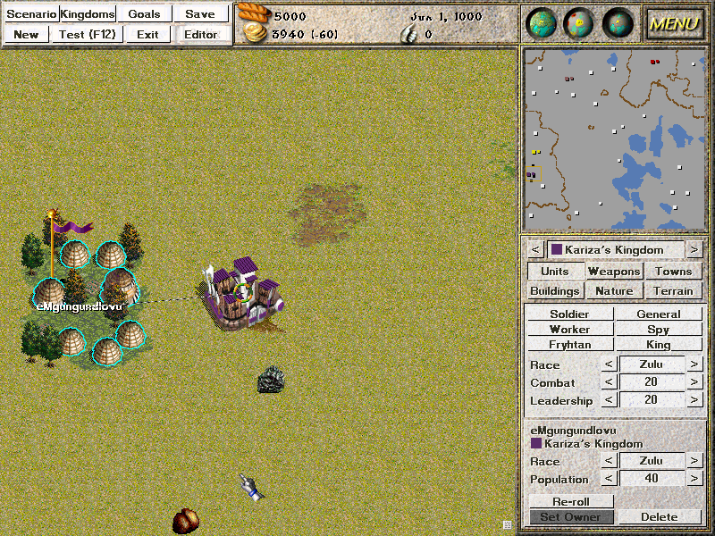

# New Adversaries Guide

[Español](GUIDE.md) | **English**

New Adversaries is a mod of **Seven Kingdoms: Ancient Adversaries 2.15.7**. This guide
explains, by topic, what is different from the original game. For the detailed history
of each version, see the changelogs.

The installer includes two versions of the game:

| | **New Adversaries Classic** | **New Adversaries** |
|---|---|---|
| Executable | `7k-newAdversaries-Classic.exe` | `7k-newAdversaries.exe` |
| What changes | Interface, convenience, scenario editor and a few adjustments | Everything in Classic, plus rule changes and the Fryhtan kingdoms |
| Saved games | `%APPDATA%\7kfans.com\7k-newAdversaries-Classic\` | `%APPDATA%\7kfans.com\7k-newAdversaries\` |

In this guide, what is marked **[NA]** is only in New Adversaries. What has no mark is
in both.

## Contents

1. [Interface and convenience](#1-interface-and-convenience)
2. [New controls](#2-new-controls)
3. [Forts, recruiting and production](#3-forts-recruiting-and-production)
4. [Rule changes [NA]](#4-rule-changes-na)
5. [Spying [NA]](#5-spying-na)
6. [Greater Beings and summoned Fryhtans [NA]](#6-greater-beings-and-summoned-fryhtans-na)
7. [Playing as a Fryhtan kingdom [NA]](#7-playing-as-a-fryhtan-kingdom-na)
8. [Scenario editor](#8-scenario-editor)
9. [More documentation](#9-more-documentation)

---

## 1. Interface and convenience

### On-screen messages
- **"Game Paused"** at the top of the map while the game is paused.
- **"Game Speed: N"** for 10 seconds when you change the speed, unpause, or start or
  load a game.
- **Training bar:** a small green bar over your towns, War Factories, Harbors (and
  lairs, in Fryhtan kingdoms) shows the progress of what is being trained or built.

### Selecting units
- **The selection box prefers military units:** if there are soldiers, weapons or war
  ships inside, only those are selected and civilians are ignored. With `Alt`, all are
  selected.
- **Number of selected units** on the right of the panel's bar.
- **List of units:** with several units selected, the **">"** button shows the list
  with their portrait, hit points and level. At the bottom, a panel with the unit in
  focus: its title, name, combat and skill.
  - **Click:** puts the unit in focus, keeping the selection.
  - **Double click:** keeps only that unit selected.
  - **`Ctrl` + click:** centers the view on it.
  - **Right click:** removes it from the selection.
- **Units of other kingdoms:** a box with none of your units now selects something: the
  most important unit inside, and its list shows all of them, grouped by kingdom. Their
  combat is not revealed.

### Groups
- `Ctrl+1`–`9` saves the selection as a group; `Alt+1`–`9` selects it, and pressing it
  twice in a row also centers the view on it.
- **Group buttons:** on the right edge of the map, above the news buttons, there is a
  button for each group that has units. A click selects it, a double click also centers
  the view.
- A unit's panel shows its group number next to the kingdom color, and the list reads
  "Group N" when the selection is a whole group.

### Panels with more information
- **Attack power and armor** in the units' panel: "Melee pwr", "Ranged pwr" and
  "Armor". If a nearby general gives them a bonus, it shows with an arrow and the
  percentage.
- **Fryhtans** show their combat, power and armor (they used to show nothing).
- **Loyalty breakdown:** hovering over the loyalty of one of your generals or soldiers
  shows what it is made of.
- **King's portrait** of each kingdom in the kingdoms report (F1).
- **Fryhtan portraits** in the lists of units and of fort soldiers.

### Generals and honors
- A general gets unhappy if his battle **contribution** is much greater than what you
  have paid him in rewards. Now you can see it:
  - **Military report (F5), Contributions tab:** your generals sorted by risk, with
    their status ("Content", "Unrewarded", "At risk!") and what honoring them costs.
    **Pay selected** and **Pay all** pay the honors.
  - **Request for honors:** when a general reaches the limit, a news message appears and
    you can accept or reject his request.

---

## 2. New controls

| Action | What it does |
|---|---|
| `Ctrl+1`–`9` | Saves the selection as a group |
| `Alt+1`–`9` | Selects the group; twice in a row centers the view |
| `Alt` + box | Selects all units, civilians included |
| Group buttons (right edge of the map) | Click selects; double click centers the view |
| List of units: click / double click / `Ctrl`+click / right click | Focus / only that unit / center / remove |
| `Shift` + click on Train (fort) | Queues 8 soldiers |

The full list of keys of the game and the mod, and how to change them, is in
`KEYBINDINGS.en.md`.

---

## 3. Forts, recruiting and production

- **Recruit in the fort:** recruits a unit from the linked town straight into the fort.
  **Train** queues a soldier that goes into the fort on its own when done.
- **Recruit in mines, factories, Towers of Science and War Factories:** like in the
  fort, but with the building's profession.
- **Automatic recruiting** in those buildings: a button turns it on or off. In Classic
  it is on by default, as in the original; **[NA]** in New Adversaries it is off.
- **Units outside the fort:** the fort's panel keeps showing, darkened, the general and
  soldiers who left it. Clicking one takes the camera to it.
- **Withdraw:** button on page 1 of the fort that brings back everyone who left.
  Alert / At ease moves to page 2.
- **Starting independent towns** have 15 to 29 people, and towns of several races have
  less resistance.

---

## 4. Rule changes [NA]

### Towns
- **Train Captain:** trains a general of the king's race (30 leadership) for $150. Only
  in towns where the king's race is the majority.
- Independent towns have at most **2 races**.
- A town of another kingdom that **surrenders** starts with more loyalty and cannot
  rebel for 90 days.

### Harbor: raw material trade
- The Harbor can produce clay, copper or iron like a mine without workers. **Hire
  Shipment** ($500) gives it 500 of supply.

### New technologies (Tower of Science → Technologies)

| Technology | Effect |
|---|---|
| Elite Warriors | Trained soldiers start with 30 combat (was 20) |
| Elite Workers | Trained workers start with 30 skill |
| Building Repair | All your buildings recover 1 hit point every 5 days |
| Fryhtan Slayers | Your soldiers deal 30% more damage to Fryhtans |

### Combat and races
- **Armor by race:** some races gain armor as their combat grows.
- **General's bonus:** a general with at least 4 of his soldiers nearby gives them his
  leadership as a damage bonus and +1 armor.
- **Race adjustments:** the Chinese, Egyptians, Japanese and Mughuls learn their special
  attacks at another combat level; the Zulus are 25% faster.
- **Shots are no longer blocked** by buildings, walls or mountains.

The exact numbers are in `COMBAT_ANALYSIS.en.md`.

---

## 5. Spying [NA]

- **Propaganda** in independent towns: much stronger than "Sow Dissent", especially with
  a spy of the town's race and one of your forts linked. Sometimes a villager joins your
  kingdom.
- **Counter-Spy** in independent towns: your counter-spy can catch other kingdoms'
  spies.
- **Gather Intel:** your spies gather information, and every few months you receive an
  **intelligence report** on the spied kingdom ("Intelligence" tab of the spies report).
  It replaces "Steal secrets".
- **Accidents:** accidents can happen in buildings with workers, and spies can cause
  them.
- **Bribery:** each option shows its chance of success.

All the details are in `SPYING.en.md`.

---

## 6. Greater Beings and summoned Fryhtans [NA]

### Greater Beings
- **Dragon (Norman):** its power is a much stronger fireball, with a larger area.
- **Djini (Mughul):** besides lowering loyalty, it converts an enemy soldier.
- **Phoenix (Greek):** exposes and executes an enemy spy in one of your towns.
- **Lord of Healing (Persian):** heals more inside forts, and also heals your Fryhtans.
- The Chinese Jing Nung spends less per attack and the Phoenix less per day.

### Summoning Fryhtans
- The **Seat of Power** has a button to summon an allied Fryhtan of your race (for
  example, Rokken for the Persians), paying prayer points.
- They are permanent, eat, regenerate hit points, can enter your forts as soldiers and
  carry an icon with your kingdom's color.
- The AI also summons them and uses them in its attacks.

Details in `GREATER_BEINGS.en.md`.

---

## 7. Playing as a Fryhtan kingdom [NA]

Single player games only. In **New Game**, the **Fryhtans** tab lets you choose one of
the 13 species. The kingdom is called "<name> <species> Horde" and its king is the **All
High**.

### How it starts
- The All High inside a **lair** with 4 soldiers of its species, and a linked
  **enslaved town** of 20 people.
- Starting Life Points by the **Treasure** option: 150, 300, 500 or 700.
- All kingdoms start on the largest land mass, because Fryhtans cannot cross the sea.

### Differences from a human kingdom
- No human buildings, no reputation and no loyalty for its Fryhtans.
- No trade, friendship or alliances with humans; war, cease-fire, tribute and aid are
  possible.
- **Wild Fryhtans do not attack you** (unless you attack them).
- **Succession:** if the All High dies, the Ordo with the most combat takes his place.
- You lose only when you have no lairs and no Fryhtans left.

### Life Points (LP)
The Fryhtans' currency, next to gold and food on the top bar.

- **Earned** by killing (more for enemies with more combat, generals and kings), from
  the tribute of enslaved towns (1 a month per 10 villagers, and 1 more with 15 or more)
  and from villagers who die in your towns.
- **Spent** on training Fryhtans, promoting Ordos, building lairs and researching
  technologies.

Also, killing humans gives **spoils** of gold and food by their combat level (much more
for generals and kings).

### Lairs
- They work like forts: a leader (an Ordo or the All High) and soldiers. They are built
  with **Build → Lair** ($500 and 30 LP).
- **Places by species:** species with many hit points fit fewer. Rokken 4; Wyrm, Droog,
  Haubudam and Sauroid 5; Holgh, Karrotten and Pfith 6; the rest 8.
- **Train** trains a soldier of the lair's species and **Train Ordo** a general. If the
  lair is full, the new one stays outside.
- **Promote / Demote** promotes a soldier to **Ordo** (with his own name) or demotes him.
- **Capturing wild lairs:** a wild lair near one of yours shows an offer; with **Pay
  Tribute** it joins your kingdom with an Ordo and its soldiers, and trains its own
  species.

| | Gold | LP (soldier) | LP (Ordo) |
|---|---|---|---|
| Ick, Doink, Broosken | $100 | 7 | 12 |
| Deezboanz, Rattus, Pfith | $100 | 8 | 13 |
| Karrotten, Holgh, Droog | $150 | 9 | 14 |
| The rest | $150 | 10 | 15 |
| Promote to Ordo | — | 5 | — |

### Enslaved towns
- **How to enslave:** a lair with a leader linked to an independent town lowers its
  resistance; to bring it down all the way you have to fight. For a town of another
  kingdom, you lower its loyalty by fighting.
- **Raid:** in an independent town linked to your lair, the Raid button assaults it to
  lower its resistance and take spoils.
- They pay **tribute** in gold and LP every month, produce food and grow, but do not
  recruit or pay taxes.
- They need a linked lair **with a leader inside**; otherwise they do not pay and their
  loyalty drops.
- **Overpopulation:** with 30 people or more (32 with Dominion), the town loses loyalty
  and ends up rebelling. The town panel has two pages: **1** with the tribute and **2**
  explaining overpopulation.

### The Ordo inside the town
An Ordo can enter an enslaved town and give it an order:

| Order | What it does |
|---|---|
| **Subjugate** | Raises loyalty; if the town reaches overpopulation, kills villagers to prevent rebellions |
| **Kidnap** | Every so often 2 new villagers arrive in the town |
| **Taskmaster** | The town produces more food, but forced labor kills a villager from time to time |

With an Ordo inside you can also use **Cull Population** (sword button): it kills 3 or
4 villagers for a little gold, food and LP. Without an Ordo, the town reads "Send an
Ordo to enable actions."

### Lair technologies
Researched with the **Research** button (page 2 of the lair). The cost is paid once, to
unlock it; you can switch technologies and each keeps its progress. They take 6 months.

| Technology | Cost | Requires | Effect |
|---|---|---|---|
| **Alchemist Lair** | $500 + 20 LP | — | You can build lairs on raw material sites; with a leader inside, they turn 50 raw material into 5 LP every 15 days |
| **Brood Mastery** | $1,000 + 30 LP | — | Training and promoting Fryhtans costs 20% less gold and LP |
| **Empowerment** | $1,500 + 50 LP | Brood Mastery | Trained Fryhtans get +10 combat |
| **Dominion** | $1,000 + 30 LP | — | +10 loyalty in enslaved towns; overpopulation starts at 32 |
| **Sacrificial Rites** | $1,000 + 30 LP | Dominion | A town with an Ordo that reaches overpopulation sacrifices 5 villagers for extra LP |

---

## 8. Scenario editor

Opened from **Single Player → Scenario → New** (or **Edit**, to modify an existing
scenario). It lets you build a map from scratch or from a generated one:

- Place and delete units, kings, spies, towns, buildings, mines and nature.
- Edit the selection: race, combat, skill, population, loyalty, names.
- Paint terrain: grass, earth, water, hills.
- Add and remove kingdoms and change their color.
- Choose the goals, test the scenario (**F12**) and save it.

---

## 9. More documentation

In the game's `Docs` folder (as `.txt`; the `.en.txt` files are in English) and in the
repository:

| File | Topic |
|---|---|
| `KEYBINDINGS.en.md` | All the keys and how to change them |
| `ADVANCED_CONFIG.en.md` | Advanced options of `config.txt` |
| `COMBAT_ANALYSIS.en.md` | How combat works, with tables by race and Fryhtan |
| `SIEGE_WEAPONS.en.md` | Siege weapons |
| `GREATER_BEINGS.en.md` | Greater Beings and their powers |
| `SPYING.en.md` | Spying |
| `CHANGELOG*.en.md` | Detailed history of each version (game's `Changelog` folder) |
